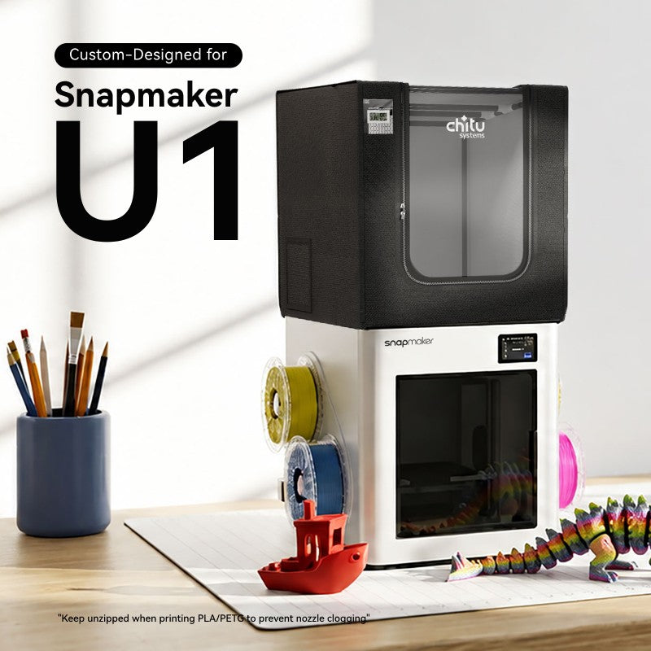
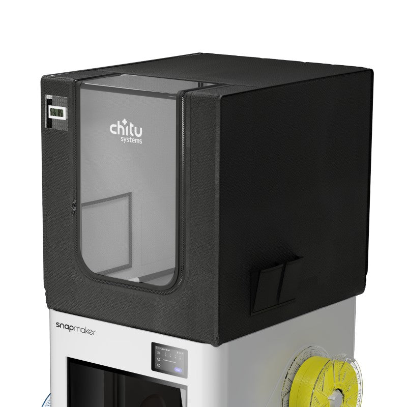
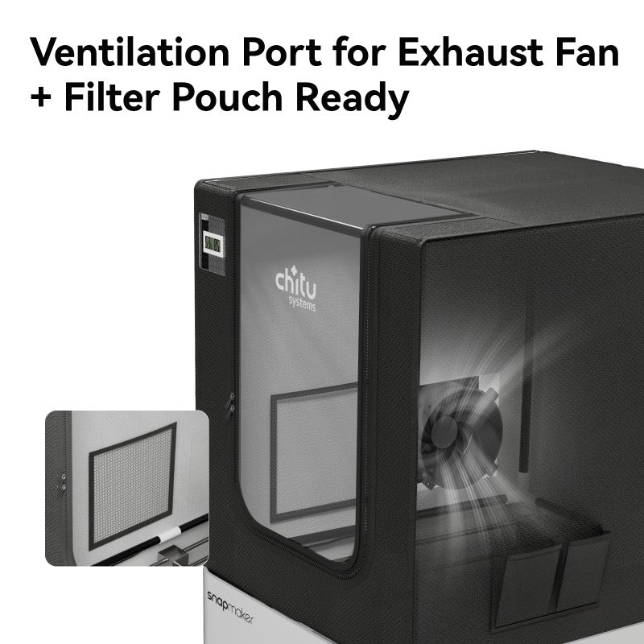
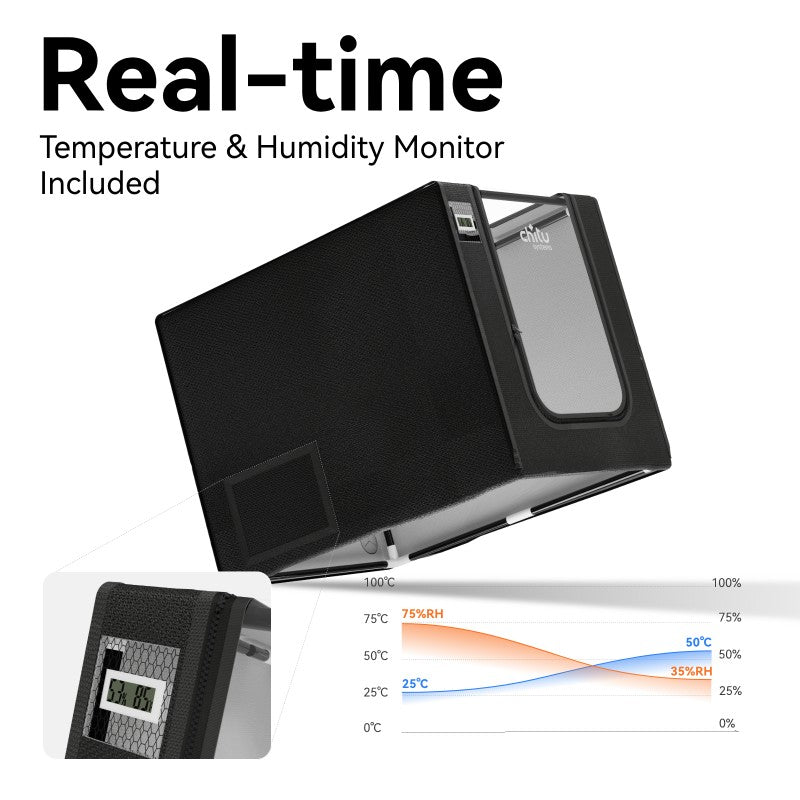
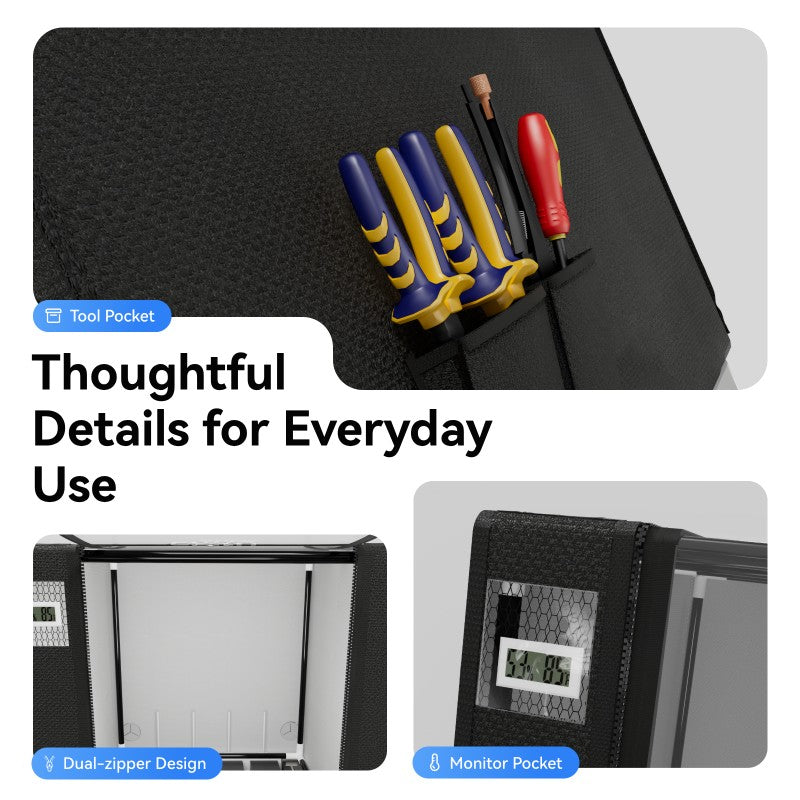
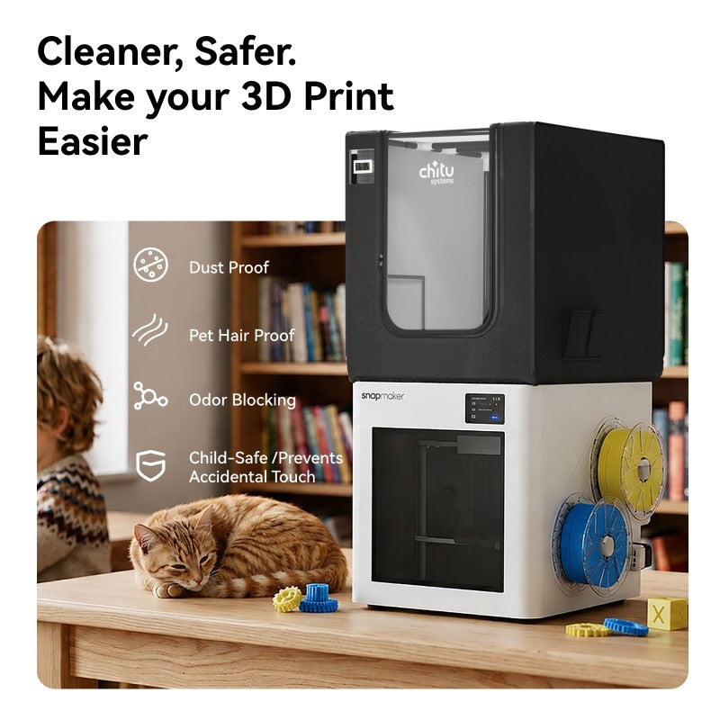

# Chitu Systems Snapmaker U1 Enclosure Integration

## Hardware Collaboration

coroNET 2 is being prepared to complement the [**Chitu Systems Snapmaker U1 Top Cover & Enclosure**](https://www.chitusystems.com/collections/chitu-systems-new-arrivals/products/snapmaker-u1-top-cover-enclosure?variant=48364859654380). Chitu Systems provides the ready-made physical enclosure and prepared routes for air and cables; coroNET provides the active, printer-aware monitoring and control layer.

This integration is being developed in contact with Chitu Systems. It does not imply that the enclosure contains coroNET electronics, and final mechanical compatibility will be declared only after both products have been tested together.

## Official Product Gallery

<table>
  <tr>
    <td width="50%"><a href="https://www.chitusystems.com/products/snapmaker-u1-top-cover-enclosure"></a></td>
    <td width="50%"><a href="https://www.chitusystems.com/products/snapmaker-u1-top-cover-enclosure"></a></td>
  </tr>
  <tr>
    <td align="center"><strong>Complete Snapmaker U1 installation</strong></td>
    <td align="center"><strong>Enclosure construction and side opening</strong></td>
  </tr>
  <tr>
    <td width="50%"><a href="https://www.chitusystems.com/products/snapmaker-u1-top-cover-enclosure"></a></td>
    <td width="50%"><a href="https://www.chitusystems.com/products/snapmaker-u1-top-cover-enclosure"></a></td>
  </tr>
  <tr>
    <td align="center"><strong>Port for the coroNET fan and iris</strong></td>
    <td align="center"><strong>Independent local temperature and humidity reference</strong></td>
  </tr>
  <tr>
    <td width="50%"><a href="https://www.chitusystems.com/products/snapmaker-u1-top-cover-enclosure"></a></td>
    <td width="50%"><a href="https://www.chitusystems.com/products/snapmaker-u1-top-cover-enclosure"></a></td>
  </tr>
  <tr>
    <td align="center"><strong>Access and storage details</strong></td>
    <td align="center"><strong>Ready-made enclosed workspace</strong></td>
  </tr>
</table>

<p align="center"><strong><a href="https://www.chitusystems.com/collections/chitu-systems-new-arrivals/products/snapmaker-u1-top-cover-enclosure?variant=48364859654380">View or buy the enclosure in the official Chitu Systems store</a></strong></p>

<p align="center"><sub>All photographs and product graphics above were published directly by Chitu Systems on the official product page. They are reproduced here with source attribution for product-identification and compatibility documentation. All image rights remain with Chitu Systems. Detailed source URLs are recorded in <a href="media/chitu-u1-enclosure/SOURCE.md">SOURCE.md</a>.</sub></p>

## Why The Products Fit Together

The Chitu enclosure is designed specifically for the Snapmaker U1. It passively reduces drafts and rapid temperature changes and includes:

- transparent front and top viewing areas;
- a roll-up, dual-zipper front opening;
- an included thermo-hygrometer and dedicated holder;
- a side opening prepared for an exhaust fan or fume-extraction path;
- a mesh pocket for a compact optional filter;
- a rear cable pass-through that can route a chamber-heater cable;
- a tool-free frame and hook-and-loop installation.

coroNET 2 already provides the active functions that a passive enclosure does not:

- live chamber temperature from printer telemetry;
- automatic, target-temperature, and manual ventilation modes;
- 25 kHz PWM fan control;
- a calibrated servo output for an iris or ventilation flap;
- stale-telemetry and connection fail-safes;
- optional Panda Breath and guarded DIY-heater workflows;
- matching control and status on the touchscreen, Android companion, and local web panel.

The intended mechanical arrangement places the coroNET-controlled fan and iris at the enclosure's side opening. The heater remains electrically independent and its cable passes through the rear opening with suitable strain relief. This preserves the enclosure fabric and avoids drilling or cutting the product.

## Intended Control Architecture

```text
Snapmaker U1 chamber telemetry
              |
              v
       coroNET 2 controller
          |             |
          v             v
   servo iris/flap   PWM exhaust fan
          \             /
           \           /
      Chitu side air opening
                |
                v
   external exhaust or suitable filter

Optional chamber heater
              |
              v
    Chitu rear cable pass-through
```

The fan, servo, and any heater require correctly rated power and driver hardware. An ESP32 GPIO must never power these loads directly.

## Planned Operating Modes

| Printing condition | Enclosure state | coroNET role |
| --- | --- | --- |
| PLA or another heat-sensitive material | Open or actively ventilated as required | Prevent excessive chamber temperature using the configured target and fan/flap response |
| ABS, ASA, or another draft-sensitive material | Closed when permitted by the filament manufacturer | Retain heat while monitoring chamber temperature and limiting overshoot |
| Heated chamber workflow | Closed with independently protected heating hardware | Coordinate targets and airflow without bypassing the heater's own safety system |
| Print complete | Material-dependent cooldown or tempering | Apply the selected ventilation, Panda Breath, or tempering workflow |
| Odor or fume management | Closed with an appropriate external air path | Drive the fan and iris; the external system determines actual filtration or outdoor exhaust performance |
| Lost or stale printer telemetry | Fail-safe output | Move fan and flap to the configured safe values instead of continuing automatic control on old data |

These are integration goals, not universal material settings. Filament manufacturer guidance, ambient conditions, printer configuration, and the capabilities of the connected exhaust, filter, or heater remain decisive.

## Validation Status

The software building blocks already exist in coroNET OS 2. The following items must still be tested with the Chitu enclosure and final airflow hardware before the integration is described as physically verified:

1. coroNET controller, status-light, cable, and touchscreen clearance;
2. side-opening dimensions and non-destructive fan, iris, and duct adapters;
3. airflow direction and useful PWM range with the selected fan;
4. iris travel, sealing, and safe servo limits;
5. rear heater-cable routing, temperature rating, abrasion protection, and strain relief;
6. chamber response with the cover open, passively closed, heated, and actively ventilated;
7. fail-safe behavior during printer disconnects and stale telemetry;
8. external filter pressure loss or outdoor-exhaust performance;
9. long-duration temperature and electrical testing.

Installation photographs, measured dimensions, printable adapters, and final build instructions will be added after physical validation.

## Product And Installation References

- [Official Chitu Systems product page and store](https://www.chitusystems.com/collections/chitu-systems-new-arrivals/products/snapmaker-u1-top-cover-enclosure?variant=48364859654380)
- [Chitu Systems enclosure selection and printing-environment guide](https://www.chitusystems.com/blogs/articles/blog-snapmaker-u1-top-cover-enclosure)
- [Chitu Systems installation guide](https://www.chitusystems.com/blogs/articles/u1-top-cover-installation-guide)

## Independence And Safety

coroNET is an independent open-source project. Chitu Systems and Snapmaker product names may be trademarks of their respective owners.

An enclosure does not by itself remove emissions, and a filter pocket does not prove filtration effectiveness. Use an appropriately engineered exhaust or filtration system for the materials being printed, follow its maintenance requirements, and never treat coroNET automation as a substitute for suitable ventilation, independent heater protection, fire precautions, or supervision.
