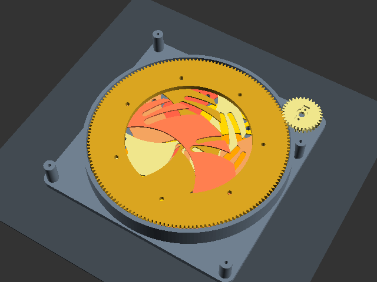
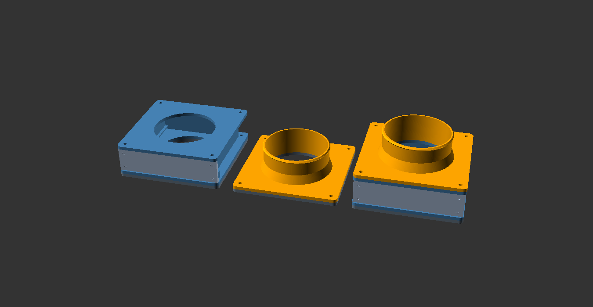

# Chitu U1 Ventilation Prototypes

These optional parts adapt the Chitu Systems Snapmaker U1 fabric enclosure
to a coroNET-controlled fan and MG90S servo. They do not replace the
[standard coroNET print project](../README.md). The packages contain
STLs, printable fit gauges where applicable, assembly documentation in
Polish, and digital validation results. OpenSCAD files are assembly previews.

**Prototype status:** CAD checks have been completed; physical fit,
head clearance, clamp strength, servo calibration, thermal endurance,
airflow, leakage and filtration performance have not been verified.

| Package | Contents |
| --- | --- |
| [N1 iris, 40 and 80 mm](CHITU_IRIS_NOWY_N1.zip?raw=true) | Seven-blade iris with MG90S and an M1 outlet. Nominal clear aperture: 38 or 76 mm. |
| [P1 butterfly damper, 40 and 80 mm](CHITU_BUTTERFLY_NOVA_P1.zip?raw=true) | Single butterfly plate driven by an MG90S. Fewer moving parts; greater outward depth and a clearance gap when closed. |
| [M1 filter and exhaust modules](CHITU_MODULOWY_M1.zip?raw=true) | Replaceable cartridge housing and duct adapters for nominal 80 or 100 mm inner-diameter flexible hose. Install a cartridge, a hose, or both in series. |

The 40 mm builds use the 12 V Noctua NF-A4x20 PWM. The 80 mm builds use
the Noctua NF-A8 5V PWM. Both N1 and P1 place moving parts, the fan and servo
outside the cover. Only the retaining frame and its fasteners sit inside.
The clamp assumes an existing 100 × 100 mm opening and 1.35 mm uncompressed
fabric. Measure your cover and use the fit gauge before printing the whole
assembly. Check head and cable clearance throughout their travel.

## Motion and Mounting

[Download the comparison gallery](CHITU_GALERIA_RUCHU.zip?raw=true):
seven animations, each paired with exterior, interior and profile views
on a modeled fabric panel. The archive also includes earlier iris
prototypes for comparison. The gallery is a CAD illustration, not an
installation photograph.

| N1 iris (80 mm) | M1 configurations |
| --- | --- |
|  |  |

The N1 80 mm build extends approximately **55 mm** outside the fabric with
its M1 base, compared with **115 mm** for P1 80 mm before its M1 base.
These dimensions exclude the hose, filter, leads and hardware protrusions.
Compare the [N1 side profile](n1-80-profile.png) with the
[P1 side profile](p1-80-profile.png).

## Before Use

- Start with the opening gauge. Dry-fit the frame and hand-cycle the mechanism
  before connecting the servo horn. Set the servo end stops for the actual assembly.
- Support the exhaust hose and any heavy filter independently of the fabric.
- The M1 cartridge envelope gauge is **not a filter**. Select suitable filter
  media and verify sealing and airflow with the filter or whole duct in place.
  None of these prototypes is a certified emissions-control or safety device.
- See the [enclosure integration guide](../../docs/CHITU_U1_ENCLOSURE.md)
  for the control architecture and validation checklist.
